# LockTech — From product inquiry to the next action

A Hebrew RTL catalog and sales workspace connecting product context, customer follow-up, and quote preparation.

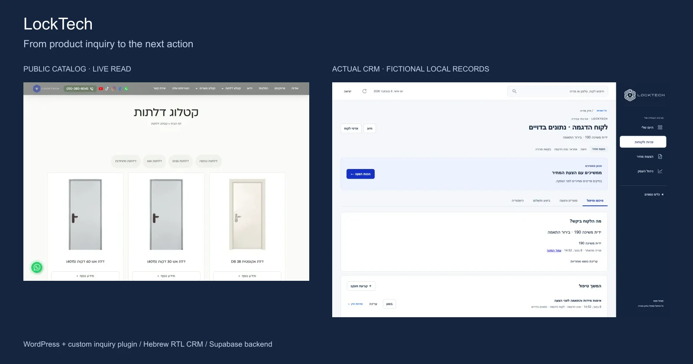

## The business problem

A product inquiry is only useful if the sales team can understand what the customer selected and decide what happens next. LockTech serves customers exploring doors and hardware, and staff who need to clarify requirements, follow up, and prepare a quote. This project connects those operational needs across an existing WordPress website and a separate CRM.

## My role

I led the requirements, workflow priorities, implementation direction, and acceptance review across the website and CRM work. My scope included product-context handoff, the Hebrew RTL operator experience, follow-up rules, quote workflows, and staged release validation. Implementation and investigation used AI coding assistance. I also directed AI-assisted visual prototyping for door/handle mockups, followed by a reusable layer-based configuration workflow. The existing WordPress platform, third-party tools, and manufacturer imagery predate or sit outside my contribution; I do not claim sole authorship of them.

## Implementation highlights

- **Visual selection supports the conversation:** real door/handle references, AI-assisted early mockups, a layered preview, and a prefilled WhatsApp handoff help the customer explain their request.
- **Context survives the handoff:** inquiry records retain source and product snapshots; an outbox and signed intake handler support retryable delivery.
- **The next action has one owner:** active tasks drive follow-up, with database triggers mirroring the earliest task into compatibility fields.
- **Quotes have a deliberate boundary:** revision-checked drafts, integer-agorot calculations, immutable issued versions, and explicit issuance separate preparation from commitment.

These are implemented mechanisms. This walkthrough does **not** establish a currently working website-to-CRM-to-delivery journey. [Evidence and limits](docs/verification-and-scope.md) explain the distinction.

## Visual walkthrough

Website images are authentic public pages captured on 6 November 2026. CRM images use the actual local application with blocked external requests and fictional HTTP fixtures. The demo customer, staff member, contact details, inquiry, and task are fictional. The CRM fixture was seeded separately; it was not created by submitting the website form. Interface text remains in Hebrew and RTL.

### 1. Discover a product

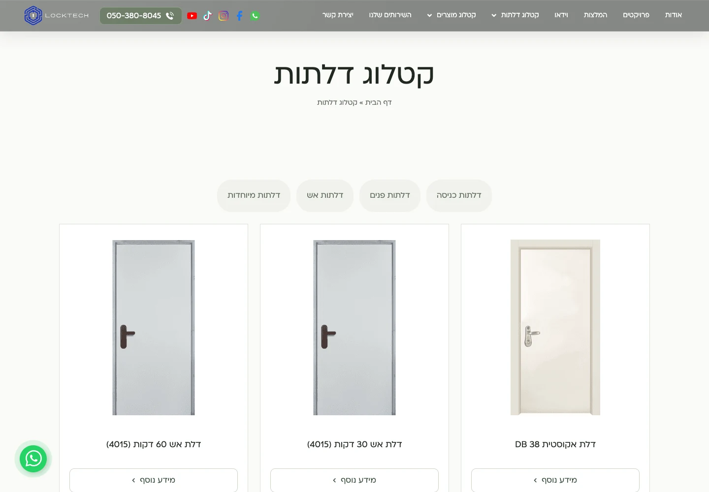

The public catalog groups real products so customers can move from discovery into a product page.

### Configure a door with a real handle

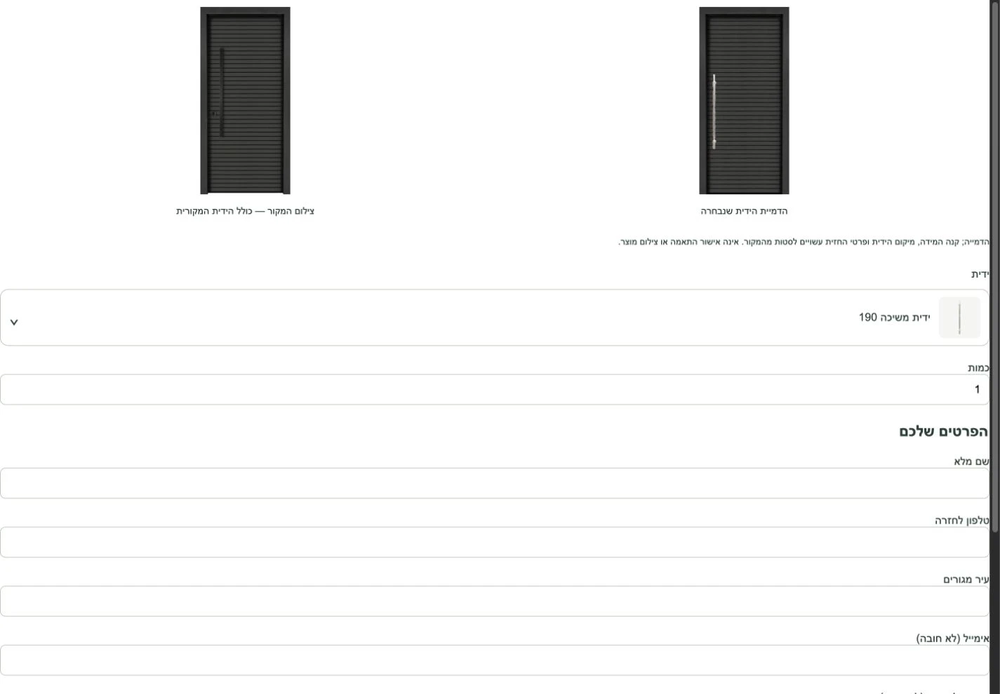

The public builder compares the original photograph with a handle visualization; the original is preserved, and the interface explicitly says the preview is not a compatibility approval or a product photograph.

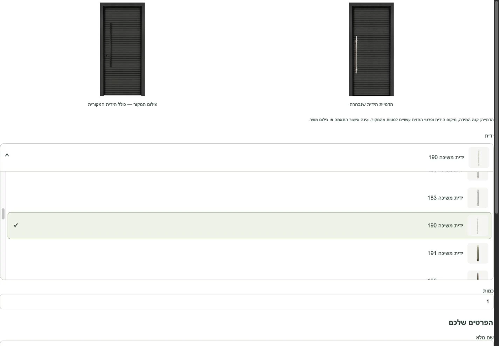

Customers select from the builder's door-specific handle list before providing contact details; availability and final fit remain subject to business review. These captures show the existing public builder opened directly from its embedded frame, with no form submission. The original CRM walkthrough below uses a standalone handle inquiry; the additional door-and-handle example follows the builder selection.

[How AI-assisted prototyping became a layered preview](docs/visual-configuration-and-whatsapp.md) explains the documented asset workflow and the difference between offline AI preparation and live rendering.

### 2. Keep the inquiry tied to its product

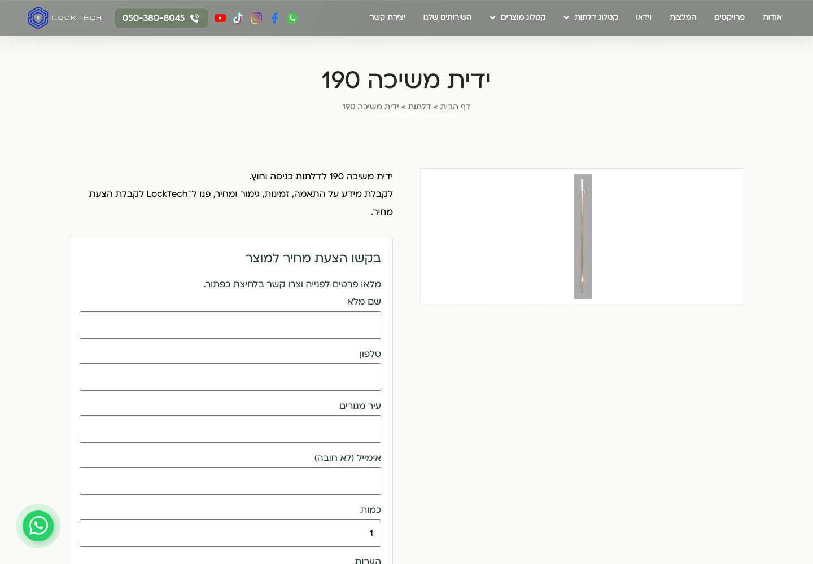

The product page collects contact details and city alongside the selected product; the form was not submitted during capture.

### 3. Start with the next action

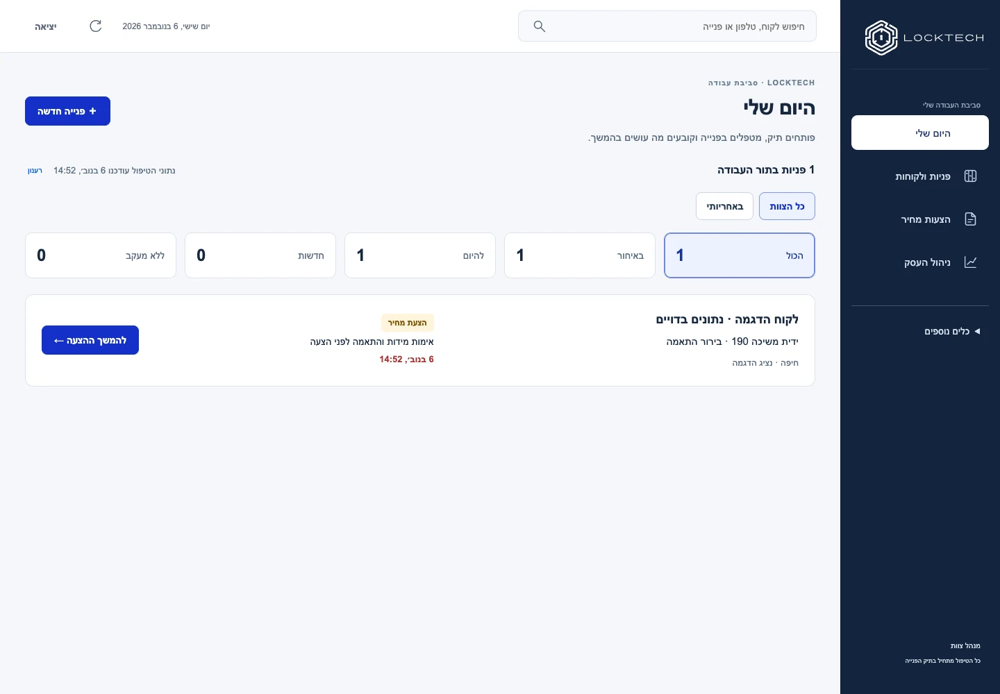

Today surfaces the fictional inquiry and its next follow-up instead of asking the operator to interpret a dashboard of unrelated totals.

### 4. Read the context in one work item

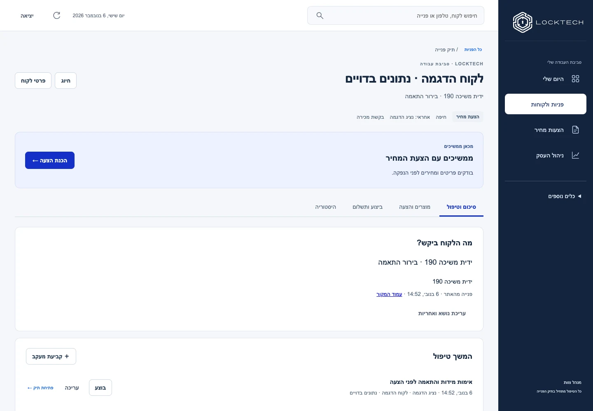

The work item keeps the request, city, responsible staff member, original source, and next task together.

### 5. Prepare a quote deliberately

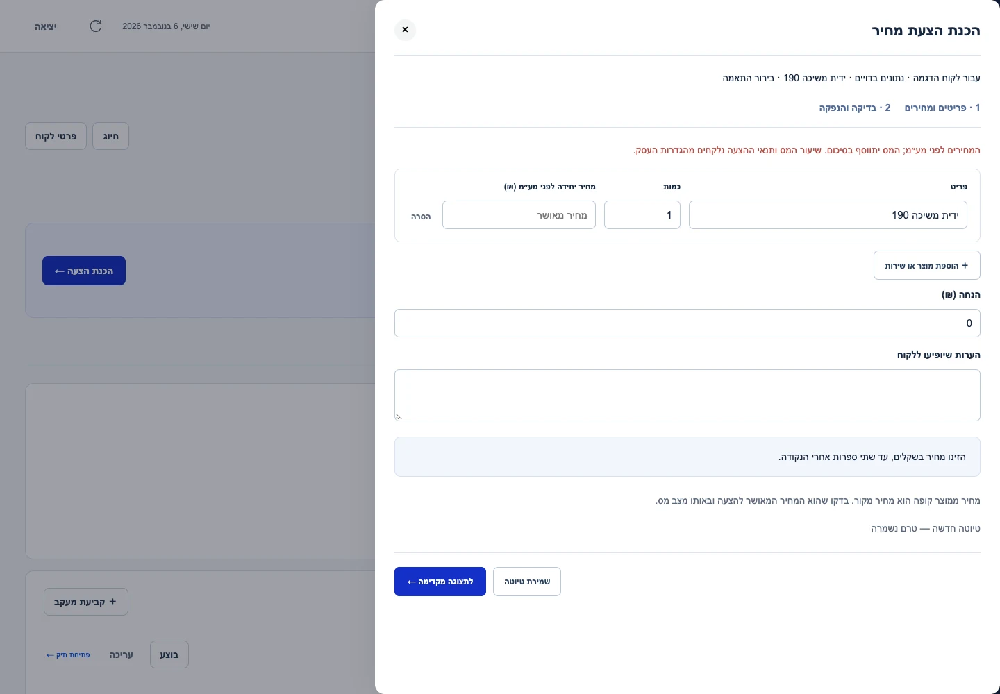

The composer carries the item forward and asks staff to enter an approved price before preview or issuance; no product price or issued quote is invented here.

### 6. Continue on mobile

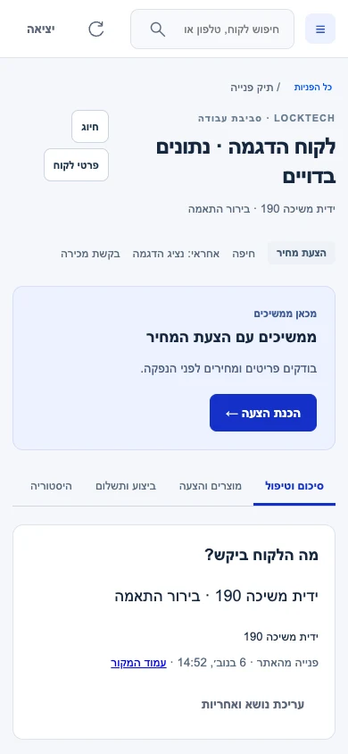

The same work item remains readable at mobile width, with no horizontal overflow in this captured state.

## Door and handle → customer case → WhatsApp

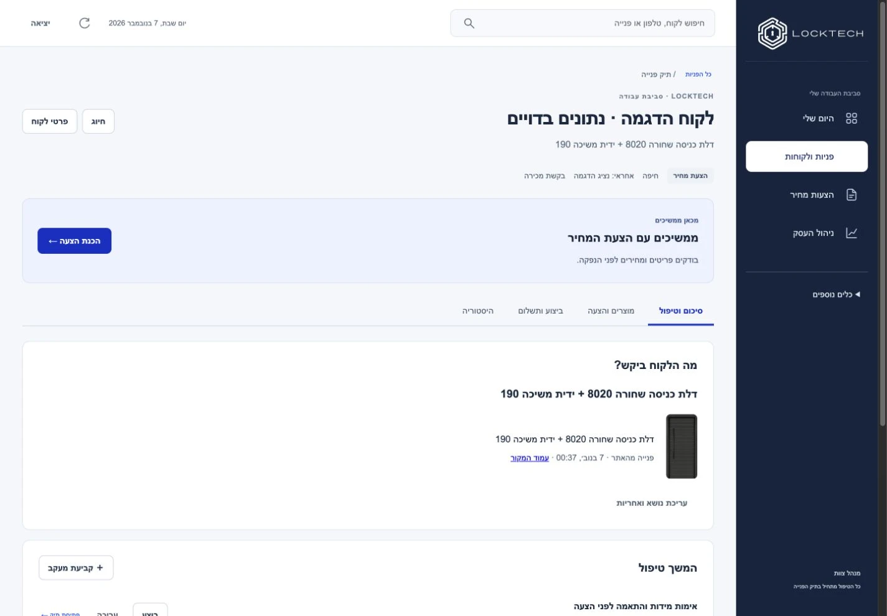

The fictional work item retains the customer, source page, door and selected handle together; its next task is to verify measurements and fit before quoting.

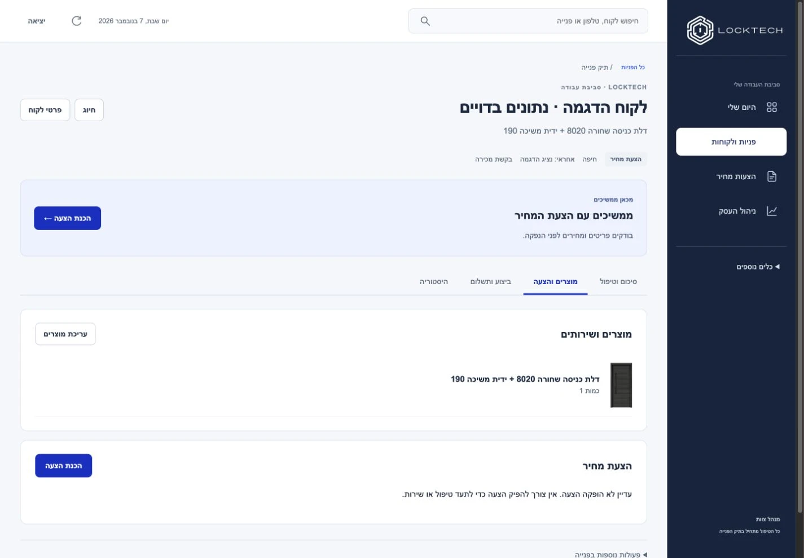

The products tab carries the selected configuration into quote preparation without inventing an approved price or an issued document.

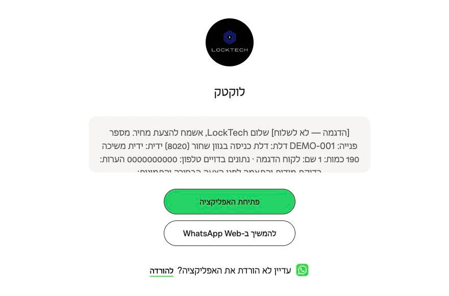

The WhatsApp handoff prepares inquiry text with the selection, contact context and a source link; the customer must still send it. This is the real WhatsApp landing screen with independently prepared fictional text based on the inspected formatter, not a sent chat or proof of delivery. No production inquiry was created. [Read the complete fictional message](examples/fictional-whatsapp-message.txt).

## System architecture

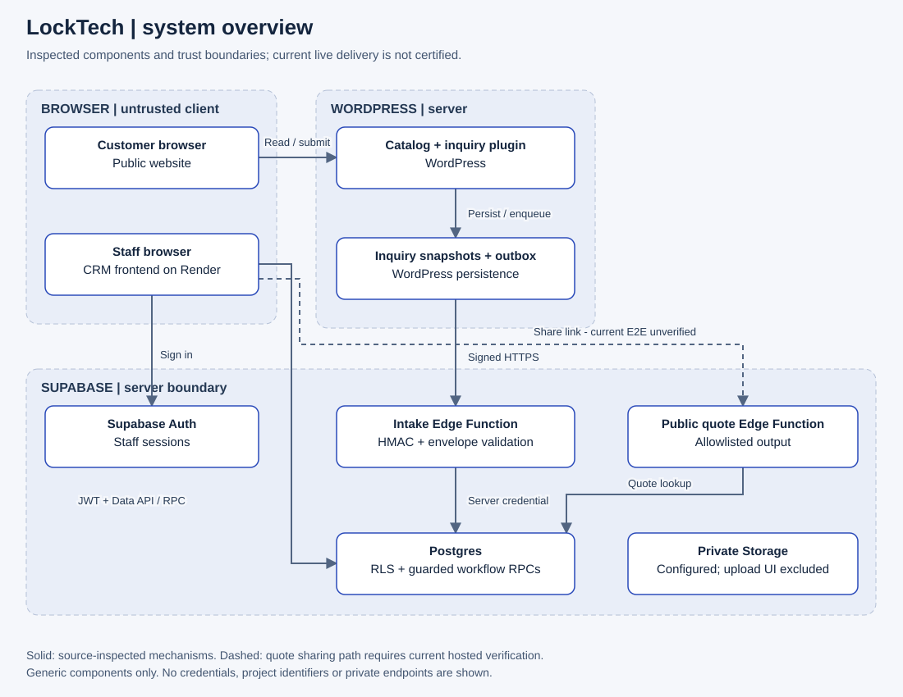

| Component | Purpose |
| --- | --- |
| WordPress + Elementor + JetEngine | Public catalog and product presentation |
| Custom WordPress PHP plugin | Product inquiry persistence and synchronization outbox |
| HTML / CSS / JavaScript on Render | Separate Hebrew RTL CRM frontend |
| Supabase Auth, Postgres and Edge Functions | Staff access, scoped records, atomic workflows and server-side integrations |

[Architecture and data flow](docs/architecture.md) · [Inquiry lifecycle diagram](assets/diagrams/inquiry-lifecycle.svg)

## Engineering decisions and trade-offs

1. **Persist before synchronization.** Local inquiry storage and a separate outbox protect the customer request when the CRM is unavailable. The cost is operating retries and monitoring failed deliveries.
2. **Use tasks as the follow-up authority.** Database mirroring supports older deal fields without requiring staff to maintain two independent schedules.
3. **Separate draft from issued quote.** Revision checks and versioned issuance protect commitments, at the cost of explicit conflict handling and confirmation steps.
4. **Keep privileged operations on the server.** Company/role checks, RLS and server-held secrets constrain access. They still require staging role tests and ongoing configuration review.

[Decision details](docs/engineering-decisions.md)

## Outcomes and evidence

The delivered application contains a task-first workspace, connected inquiry context, quote preparation, and server-side workflow safeguards. On 6 November 2026, local workspace, quote-document, analytics, and daily-workspace regression scripts passed. The actual CRM rendered against fictional fixtures without JavaScript page errors, and the captured mobile work item had no page-width overflow. Public catalog and product pages were read live without submitting forms.

The 1 November release handover records deployment and authenticated read-only inspection of CRM screens. That is historical evidence, not a fresh verification of production writes or synchronization. No measured conversion gain, time saving, revenue impact, uptime, or adoption claim is made.

**Current limitations:** hosted staging writes, current website intake delivery, public quote sharing/signing, automated message delivery, and external accounting/POS reconciliation are not certified by this review. A prior mobile website audit also found a chat overlay obstructing a product form; the clean CRM mobile screenshot does not resolve that website issue. AI-assisted visual preparation is documented; the inspected live selector composes prepared layers rather than calling a generative model for each selection.

**Proposed measurements:** inquiry-to-first-response time, outbox failure age, inquiries without a scheduled task, and draft-to-issued quote time. These are measurement proposals, not reported results.

## Explore

- [Visual configuration, AI preparation and WhatsApp](docs/visual-configuration-and-whatsapp.md): the selection and communication journey.
- [Architecture](docs/architecture.md): components, trust boundaries and inquiry lifecycle.
- [Engineering decisions](docs/engineering-decisions.md): rationale and operational costs.
- [Verification and scope](docs/verification-and-scope.md): evidence matrix, screenshot provenance, rights, and remaining gaps.
- [Rights](RIGHTS.md): included material and retained rights.

This is a documentation case study, not the complete application or a runnable demo. Production source, credentials, customer data, and access instructions are excluded.

**Yossef Davarashvili · AI Solutions & Automation | Business Analyst**

[Verified GitHub profile: Jossefo](https://github.com/Jossefo)
