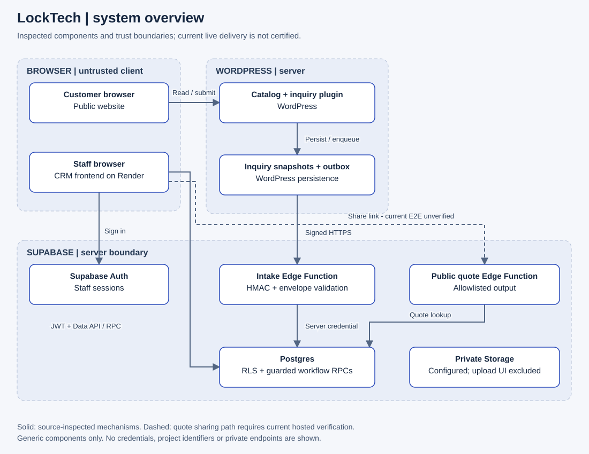
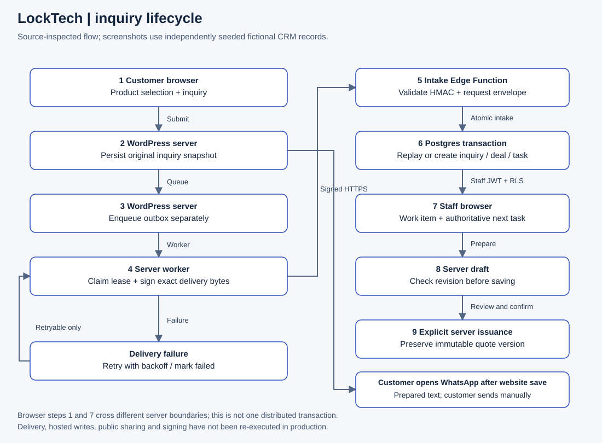

# Architecture

The website and CRM are separate applications. The catalog is WordPress-based; the CRM is a static HTML/CSS/JavaScript client hosted on Render. Supabase provides staff authentication, Postgres tables, SQL workflow functions, and Edge Functions. The reviewed source also defines a private Storage bucket; an attachment upload UI is outside the demonstrated journey.

[Editable Mermaid source](../assets/diagrams/system-overview.mmd)

## Browser and server boundaries

The public browser reads catalog pages and submits to a WordPress plugin handler. WordPress stores the inquiry snapshot and separately queues delivery. The outbox signs the timestamp and exact request bytes using HMAC-SHA256. The intake Edge Function enforces request size, timestamp freshness, signature, envelope fields, and source host before invoking an atomic SQL intake function using a server-held credential.

After confirmed website persistence, the customer browser can open a prefilled WhatsApp draft. Sending remains a separate customer action; no automated delivery or webhook receipts are claimed.

The CRM browser uses Supabase Auth and the authenticated Data API. Company membership, roles, RLS and guarded workflow RPCs enforce access on the server; hiding a button is not an authorization control. Only public client configuration belongs in the frontend. HMAC, privileged database access, and external integration credentials stay server-side.

Issued quote links use an Edge Function with allowlisted output. Current production delivery, acceptance and signing are not certified by this case study.

## Inquiry lifecycle

[Editable Mermaid source](../assets/diagrams/inquiry-lifecycle.mmd)

1. The customer selects a product and supplies contact details, including city.
2. The WordPress handler persists an inquiry snapshot. An outbox entry is queued separately; these steps should not be described as one cross-system transaction.
3. The outbox worker claims a lease and attempts signed delivery. Network errors, timeouts, rate limits and server failures are retried with bounded backoff. Other HTTP failures are marked failed. WP-Cron is traffic-dependent, so a five-minute schedule is not a delivery SLA.
4. Atomic intake locks the request identity. The same identity and payload hash return the original result; a changed payload under the same identity conflicts. One transaction creates the CRM inquiry, deal, item snapshots, initial task and activity, with customer reuse by company and normalized phone.
5. Staff see the work item and its next active task. Closing or rescheduling a task changes the authoritative follow-up.
An independent customer-facing branch opens the prepared WhatsApp draft after confirmed local persistence; it does not wait for or certify CRM delivery.

6. Quote preparation uses a revision-checked server draft. Explicit issuance validates current quote, draft and settings versions and stores an immutable quote version.

This describes inspected implementation, not a newly executed live journey. Screenshot fixtures bypass delivery entirely.

## Data responsibilities

| Record | Responsibility |
| --- | --- |
| Customer | Reusable contact within a company |
| Inquiry | Original request, source and payload hash |
| Deal / work item | Mutable operational progress |
| Deal item | Product context captured for the request |
| Task | Next action, owner, deadline and completion |
| Quote draft | Editable document with a revision |
| Quote version | Issued commercial snapshot |
| Integration event / outbox | Delivery attempts and state |

Source also contains catalog and external sales/inventory integration code. Provider connectivity and accounting reconciliation were not independently verified for this case study, so those paths are excluded from the primary implemented architecture. Automated outbound messaging and payment/accounting completion are not demonstrated capabilities.
